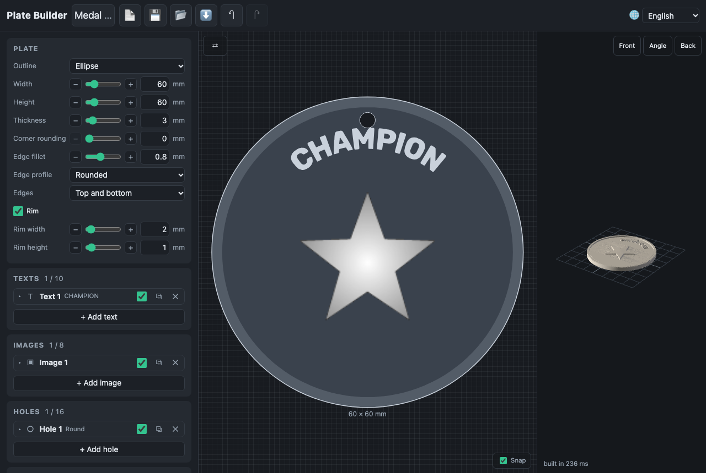

# Plate Builder

A web app that builds a flat plate for 3D printing — a door sign, a
keychain, a pet tag, a house number, a medal — and exports it as STL. Put
images whose brightness becomes relief, texts and holes on a plate, pick its
outline, and download a file ready for the slicer. Everything runs in the
browser, offline included.

**Open it: <https://dmitryweiner.github.io/plate-builder/>**



- Outlines: rectangle, ellipse, triangle, polygon, star, heart, shield, tag,
  decorative vignettes, your own SVG, or a crop around the elements; corner
  rounding and a rim.
- Images (PNG, JPEG, WebP, GIF, SVG) as relief, with levels, inversion and
  smoothing; transparency is height 0.
- Texts in six bundled fonts (Latin, Cyrillic, Hebrew), several lines,
  raised or engraved, on an arc.
- Holes: round, slot, countersunk, hidden keyhole from the back.
- Magnets in the back (a fridge magnet): 1 to 4, their size and a layout.
- A 2D editor (drag, scale, turn, snap; touch too) and a 3D preview; undo
  and redo; warnings with a "show"; colour-change heights for the slicer.
- Projects kept in the browser, project files, seven built-in presets and
  your own; English, Russian, Ukrainian and Hebrew.

The user guide is in [docs/](docs/README.md); the specification in
[docs/spec.md](docs/spec.md).

## Development

```bash
fnm use            # Node from .node-version
npm ci
npm run dev        # dev server
npm run check      # typecheck + lint + unit tests
npm run smoke      # browser smoke (-- --preview for the build and offline)
npm run build      # → dist/
```

TypeScript 7 + Vite, no framework; Three.js for the 3D view;
[manifold-3d](https://github.com/elalish/manifold) (WASM) for the geometry,
in a module worker. Built on
[maker-kit](https://github.com/dmitryweiner/maker-kit), the shared library of
the 3D-printing tools (controls, undo, storage, presets, the 3D view, the
worker queue, STL, the design code). See [AGENTS.md](AGENTS.md) for the
layout and conventions.

## License

[GPL-3.0-or-later](LICENSE).

## Credits

- **Fonts** (SIL Open Font License 1.1, the licence next to each in
  [public/fonts/](public/fonts/)): Rubik, Oswald, PT Serif, Comfortaa, Marck
  Script, Frank Ruhl Libre.
- **Vignettes**: drawn for the project, CC0 (sources and licences in
  [public/vignettes/index.json](public/vignettes/index.json)).
- **Preset pictures**: drawn for the project
  ([scripts/preset-pictures.mjs](scripts/preset-pictures.mjs)).
- Sibling projects whose code this one borrows: Case Constructor and
  ClayForm.
