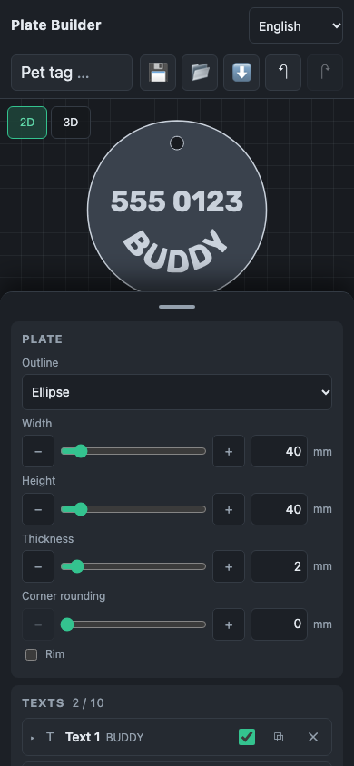

# The 2D editor

The 2D view is the plate seen from the front: its outline, images as their
height maps, texts as ink (raised dark, engraved light), holes as cut-outs, a
millimetre grid and the plate's size. The 3D view shows the solid as it will
print. On a phone one shows at a time (the 2D / 3D switch); on a wider screen
both, side by side, and ⇄ swaps their sizes.

- **Select** an element with a tap or click: its card opens in its group
  (Texts, Images, Holes) and comes into view; on a phone the panel comes up.
  A click on a card's head in the panel selects too; on the open card's head
  it deselects. A tap on empty space deselects (and on a phone hides the
  panel; **⚙ Settings** brings it back).
- **Drag** an element to move it; drag empty space to pan; the wheel or a
  pinch zooms.
- The selected element's **corner handles** scale it (the opposite corner
  stays put); the **round handle** above it turns it (in 15° steps with
  Shift). Two fingers on the selected element scale and turn it.
- **Snapping** puts the centre on the plate's axes and on other elements'
  centres, with guides; Alt, or the **Snap** switch, turns it off.
- **Keys**: arrows move by 0.5 mm (Shift: 5 mm), Delete removes,
  Ctrl/Cmd+D duplicates, Ctrl/Cmd+Z and Shift+Ctrl/Cmd+Z undo and redo,
  Escape deselects. A drag or a slider move is one undo step.
