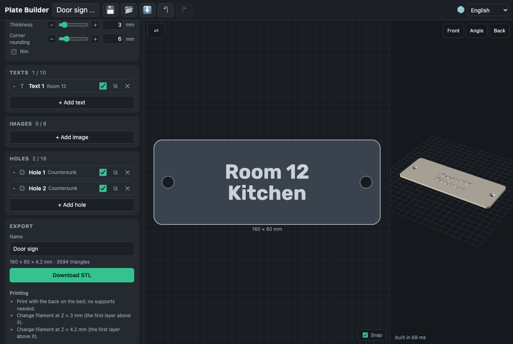

# Export and printing

**Download STL** builds the plate at full quality and saves a binary STL in
millimetres, named after the project (`door-sign.stl`). The card shows the
size, the height and the triangle count.

## Printing

- Print with the **back on the bed**; no supports are needed: everything
  rises from the base, and a keyhole's channel is a short bridge.
- **Magnets**: glue them into their pockets on the back after printing; the
  card gives their number and size.
- **Colour changes**: the card lists the heights where a filament change
  gives a clean second colour — the top of the base, of raised texts, of the
  rim and of the frame. Set a colour change at that Z in the slicer (the
  first layer above it). Images are a gradient: a change across them gives
  bands, not a picture.

## Warnings

The Warnings card names each problem and its element; **Show** frames it in
the 2D view. A plate whose mesh fails its check (not closed, inside out, too
many broken triangles, or empty) cannot be exported, and the card says why.
A relief taller than three times the base warps a thin plate as it cools.
