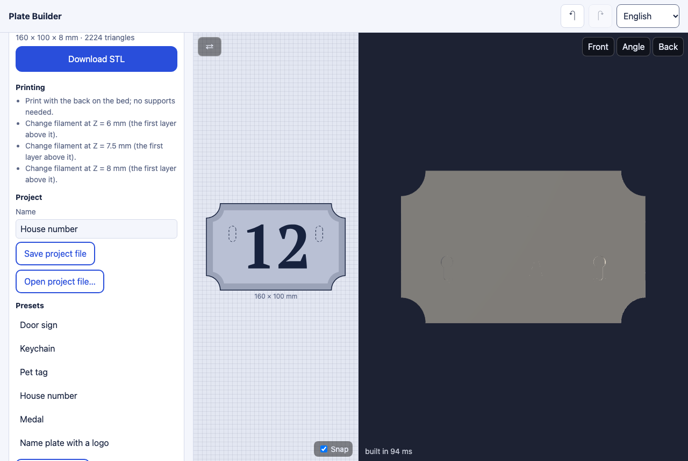

# Holes

**Add hole** puts a round hole in the middle; its card changes the kind.

| Kind                    | Sizes                          | What it is for                        |
| ----------------------- | ------------------------------ | ------------------------------------- |
| Round                   | diameter                       | a key ring, a cord, a nail            |
| Slot                    | length, width, rotation        | a strap, a hanger that slides         |
| Countersunk             | screw and head diameters       | a flat screw head flush with the face |
| Keyhole (from the back) | screw head, shank, slot length | hanging the plate on a screw, hidden  |

A **keyhole** is a pocket in the back: an entry hole for the screw head, a
slot for the shank through a lip, and a channel behind it. The plate slides
down so the screw ends at the top of the slot. It needs a thicker plate
(about 5.3 mm for an M4 screw); a warning gives the thickness needed. The
**Back** camera shows it.

Holes cut through everything over them. Warnings say when a hole has less
than 2 mm of material to the edge, pokes out of the plate, overlaps another
hole or crosses a text.
