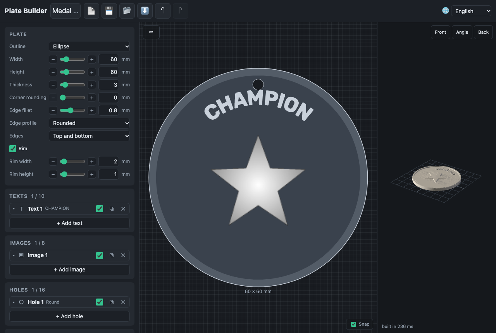
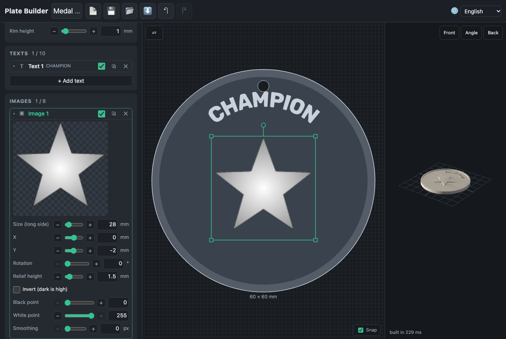

# Images

**+ Add image** in the Images card takes a PNG, JPEG, WebP, GIF (its first frame) or SVG file up to
20 MB. It is kept in the project as grayscale with transparency, at most
512 pixels on its long side.

## What becomes height

White is high, black is low, transparent is nothing: the height at a point is
the relief height × the brightness (after levels and inversion) × the
transparency. The card shows the picture as it becomes height.

| Parameter                      | What it does                                      |
| ------------------------------ | ------------------------------------------------- |
| Size                           | the long side on the plate, 5–300 mm              |
| X, Y, rotation                 | where it sits and how it is turned                |
| Relief height                  | the height of white, 0.1–10 mm                    |
| Invert                         | dark becomes high (a dark logo on white)          |
| Black point, white point       | the levels: what is fully low and fully high      |
| Smoothing                      | a blur of 0–5 pixels, for photos and jagged scans |
| Crop threshold, In the outline | only with the crop outline (see the plate)        |

Where images overlap, the higher one wins. Images are always raised; an
engraved image is not in this version.

A picture of 512 pixels on a 150 mm plate is 0.3 mm per pixel — finer than a
0.4 mm nozzle prints. Exports use a grid of the picture's pixel size (0.1 to
0.2 mm); the preview a coarser one, of up to 0.5 mm on a big picture.

Fine line art wants room: a stroke of a few pixels on a 35 mm picture is
0.3 mm wide, thinner than the nozzle, and prints as a blur whatever the
STL. Make such a picture larger, or thicken its lines with a little
smoothing and a lower white point.
