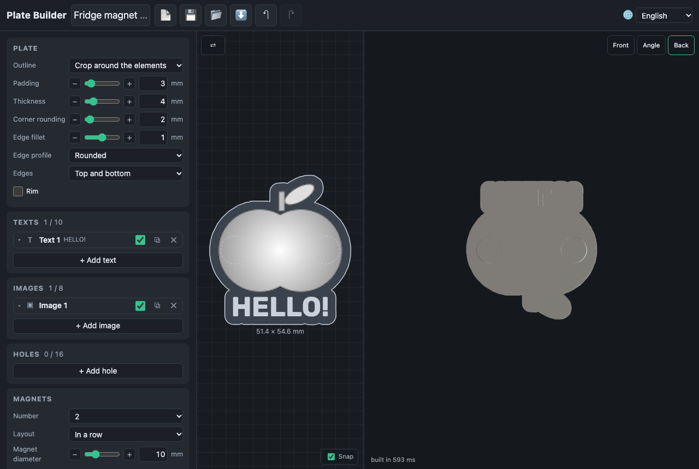

# Magnets

The **Magnets** card sets round magnets into the back of the plate, for a
fridge magnet or a board. Each magnet gets a pocket: open at the back, to
glue the magnet in after printing, or closed inside the plate, to put the
magnet in during a pause of the print. The **Fridge magnet** preset starts
with two, glued.

| Setting             | What it does                                                                             |
| ------------------- | ---------------------------------------------------------------------------------------- |
| Number              | none, or 1 to 4 magnets, all of one size                                                 |
| Layout              | where they go; each number has its own (below)                                           |
| Mount               | glued in from the back, or sealed inside during a print pause (below)                    |
| Depth from the back | sealed: 0.2–5 mm of plastic between the back face and the magnet (0.4 mm)                |
| Magnet diameter     | 3–30 mm, the magnet's own                                                                |
| Magnet thickness    | 0.5–10 mm, the magnet's own                                                              |
| Fit                 | 0–1 mm added to the diameter: room for the glue and for the printer's tolerance (0.2 mm) |
| From the edge       | 1–30 mm of material between a pocket and the plate's edge                                |

| Number | Layouts                                                                      |
| ------ | ---------------------------------------------------------------------------- |
| 1      | in the middle; at the top (the plate then hangs straight instead of turning) |
| 2      | in a row; in a column; the top corners                                       |
| 3      | a triangle, its point up or down; in a row; in a column                      |
| 4      | the corners; a diamond (the middles of the sides); in a row; in a column     |

The pocket is the magnet's diameter plus the fit across, and 0.1 mm deeper
than the magnet, so the magnet sits flush with the back: a magnet holds much
less with any gap between it and the fridge. The card shows the pocket's
size.

**Sealed** magnets need no glue and do not show. The pocket starts at the
depth from the back (keep it thin: every tenth of a millimetre between the
magnet and the fridge weakens the hold) and ends on the first 0.2 mm layer
boundary over the magnet. The Export card says where to pause: "Pause the
print at Z = 2.6 mm (the first layer above it)". In the slicer, add a pause
before the layer that starts at that height (PrusaSlicer, Bambu Studio,
OrcaSlicer: the layer slider's menu, _Add pause_; Cura: the _Pause at
height_ post-processing script). When the printer stops, put the magnets in
— all with the same side up if they must attract each other — and resume.
With layers that do not divide 0.2 mm (0.12, 0.28 mm) or a thicker first
layer, pause before the first layer that lies above the height.

The layouts follow the plate's outline. A corner of a circle, a heart or a
crop is not where the box's corner is: a magnet that would come closer to
the edge than the setting slides towards the middle until it fits. The 2D
view draws the pockets dashed, as they are hidden behind the front; the
**Back** camera shows the glued ones. They cannot be dragged.

Warnings say when the plate is too thin to leave 0.8 mm over a pocket (with
the thickness needed: a sealed pocket counts its depth from the back too), when the magnets do not fit with their edge or come
too close to each other, and when a pocket runs into a hole or under an
engraving that would leave less than 0.4 mm between them.
