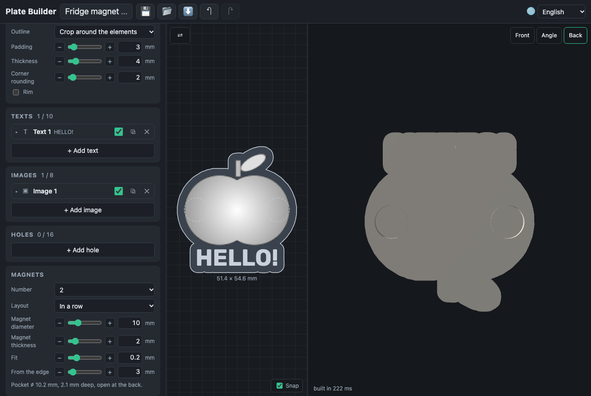

# Magnets

The **Magnets** card sets round magnets into the back of the plate, for a
fridge magnet or a board. Each magnet gets a pocket open at the back; glue
the magnets in after printing. The **Fridge magnet** preset starts with two.

| Setting          | What it does                                                                             |
| ---------------- | ---------------------------------------------------------------------------------------- |
| Number           | none, or 1 to 4 magnets, all of one size                                                 |
| Layout           | where they go; each number has its own (below)                                           |
| Magnet diameter  | 3–30 mm, the magnet's own                                                                |
| Magnet thickness | 0.5–10 mm, the magnet's own                                                              |
| Fit              | 0–1 mm added to the diameter: room for the glue and for the printer's tolerance (0.2 mm) |
| From the edge    | 1–30 mm of material between a pocket and the plate's edge                                |

| Number | Layouts                                                                      |
| ------ | ---------------------------------------------------------------------------- |
| 1      | in the middle; at the top (the plate then hangs straight instead of turning) |
| 2      | in a row; in a column; the top corners                                       |
| 3      | a triangle, its point up or down; in a row; in a column                      |
| 4      | the corners; a diamond (the middles of the sides); in a row; in a column     |

The pocket is the magnet's diameter plus the fit across, and 0.1 mm deeper
than the magnet, so the magnet sits flush with the back: a magnet holds much
less with any gap between it and the fridge. The card shows the pocket's
size.

The layouts follow the plate's outline. A corner of a circle, a heart or a
crop is not where the box's corner is: a magnet that would come closer to
the edge than the setting slides towards the middle until it fits. The 2D
view draws the pockets dashed, as they are hidden behind the front; the
**Back** camera shows them. They cannot be dragged.

Warnings say when the plate is too thin to leave 0.8 mm over a pocket (with
the thickness needed), when the magnets do not fit with their edge or come
too close to each other, and when a pocket runs into a hole or under an
engraving that would leave less than 0.4 mm between them.
