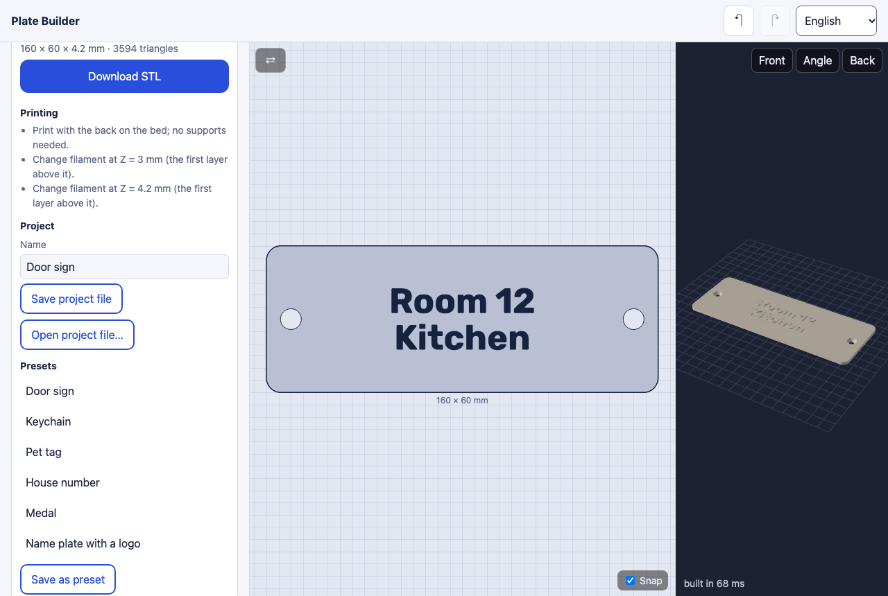
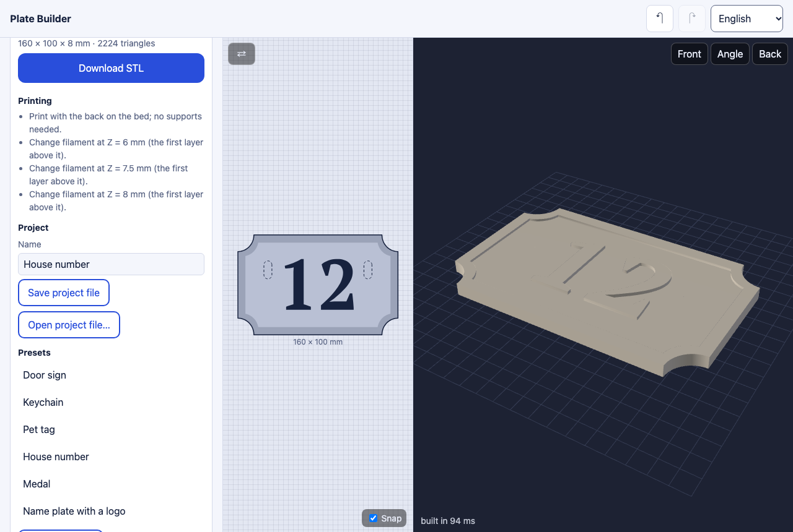

# The plate

The **Plate** card sets the plate's outline and its base. Everything is in
millimetres; the plate prints with its back on the bed.

## Outline

- **Rectangle, ellipse, triangle, polygon, star, heart, shield, tag** — drawn
  from a formula to the width and height you give. A polygon has 5–12 sides;
  a star 4–12 points and an inner ratio (how deep its notches go).
- **Vignette** — a decorative frame from the catalog (pick it from the
  thumbnails). Its outer edge is the plate's outline. With **Raised frame**
  on, the frame itself stands on the base by its **frame height**; off, the
  vignette is only the plate's shape. **Keep proportions** fits the frame
  inside width × height; off, it is stretched to them.
- **Own SVG** — any SVG you upload: its filled area is the plate. It is drawn
  by the browser, so a file's scripts never run. A file with several separate
  pieces gives several islands, and a warning says so.
- **Crop around the elements** — the outline follows your images and texts,
  grown by the **padding**. An image takes part where its height is above
  its crop threshold; each image and text has an **In the outline** switch.
  Holes inside the outline are filled; holes (the element kind) take no part,
  so give them something of the crop around them (the keychain preset puts a
  letter O around its hole).

## Base and edges

- **Thickness** (0.6–20 mm) is the base; reliefs stand on it, holes and
  engravings cut into it.
- **Corner rounding** turns every convex corner into an arc of that radius,
  and the plate keeps its size. On a crop, rounding is capped at the padding,
  so it never eats thin strokes the padding did not cover.
- **Rim** — a raised border along the outline, any kind of outline, with its
  width and height. Holes cut through it.
