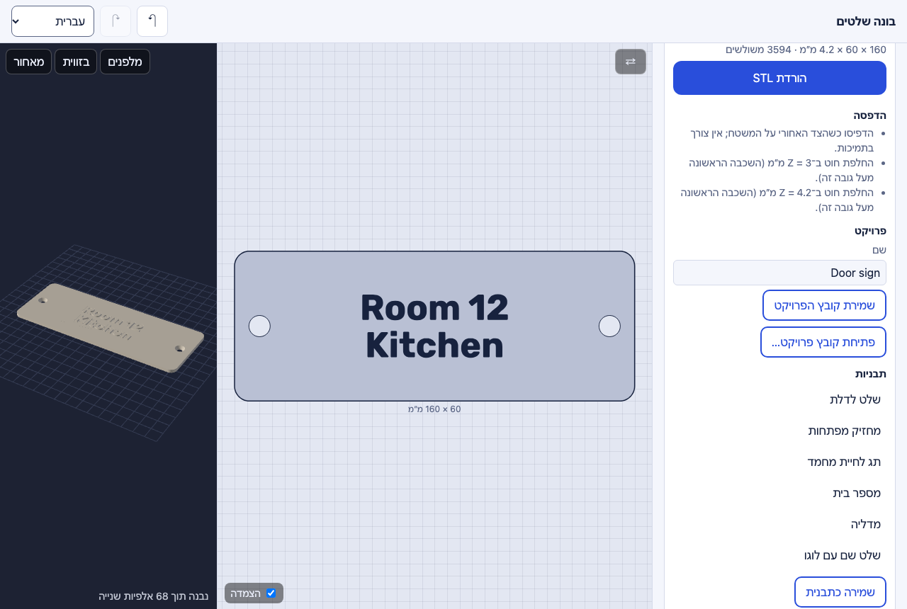

# Projects and presets

The plate you work on is kept in the browser and comes back on the next
visit. If the browser refuses to keep it (its storage is full, or a private
window), a banner says so: save the project file instead.

- **Name** — the project's name; files are named after it.
- **Save project file** / **Open project file…** — a `*.plate.json` file with
  everything in it, pictures included. A file from another app, a broken one,
  or one from a newer version is refused with a message. Opening a project
  is one undo step: undo brings back the one that was open.
- **Presets** — six built-in plates to start from: a door sign, a keychain, a
  pet tag, a house number, a medal and a name plate with a logo. A first
  visit opens the door sign. **Save as preset** keeps the current plate as
  your own preset (rename it in its field, delete it with ✕). The preset
  opened last says _changed_ once you edit it.

The interface speaks English, Russian, Ukrainian and Hebrew (right to left);
it follows the browser's language until you pick one.
