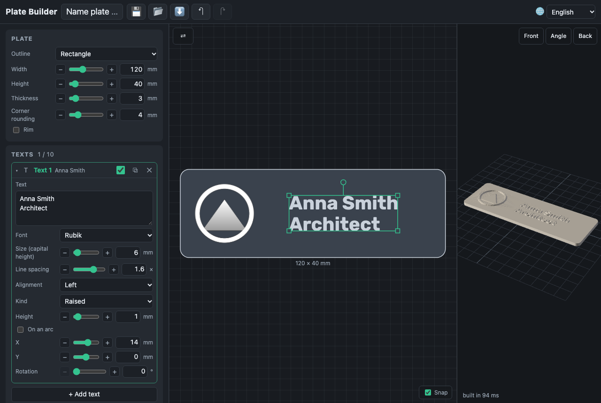

# Texts

**+ Add text** in the Texts card puts a block of up to 10 lines and 300 characters on the plate.

- **Font** — Rubik (Latin, Cyrillic, Hebrew), Oswald, PT Serif, Comfortaa,
  Marck Script (Latin, Cyrillic) and Frank Ruhl Libre (Latin, Hebrew). They
  are bundled with the app and load the first time a text uses them; a text
  waits for its font rather than showing in another one.
- **Size** is the height of a capital letter, 2–100 mm. **Line spacing** is
  the distance between lines as a share of the size; **alignment** is per
  block.
- **Raised** text stands on the plate by its **height**; **engraved** text is
  cut into it by its **depth** (at most the thickness less 0.4 mm), through
  images and the rim too.
- **On an arc**: the block becomes one line (a warning says when lines were
  joined) bent around a circle of the **arc radius**, whose centre is the
  text's position. **Outside, along the top**: letters stand on the circle
  and read clockwise. **Inside, along the bottom**: letters stand towards the
  centre, upright, reading left to right. A text longer than its circle is
  squeezed to fit, with a warning.

Strokes thinner than 0.8 mm (two nozzle widths) get a warning: a size of
4–5 mm is about the smallest a bold font prints well.
